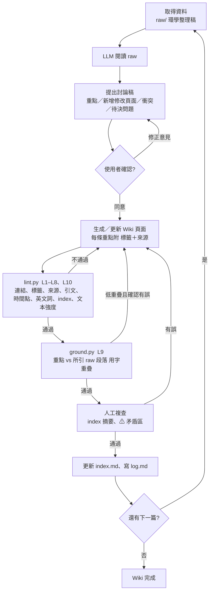
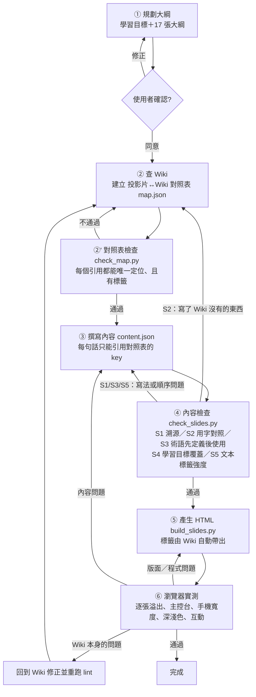

# 步驟三：loop／graph 設計說明

我把整個作業拆成兩段：**建 Wiki 的迴圈**（每一集資料跑一次）和**做簡報的 graph**（一直跑到所有檢查都通過）。兩段的分工原則相同：**AI 負責產出內容，判斷「方向對不對」的是我，判斷「每一句有沒有根據」的是檢查程式。** 任何一關沒過，就退回前面的節點重做。

---

## 一、Wiki 建置迴圈（每篇 raw 資料跑一次，共 6 次）



| 節點 | 誰做 | 會重複嗎 | 會退回嗎 |
|---|---|---|---|
| 取得資料 | 一次性複製 6 集 | 每篇 1 次 | — |
| 討論稿 | LLM 提出、使用者決定 | 每篇 1 次以上（有修正意見就重寫） | 使用者不同意 → 重寫討論稿 |
| 生成頁面 | LLM | 每篇 1 次以上 | 任何檢查不通過都退回這裡 |
| lint（L1–L8、L10） | `tools/lint.py` | 每次修改後都重跑 | 退回「生成頁面」 |
| L9 引用對照 | `tools/ground.py` | 每次修改後都重跑 | 退回「生成頁面」 |
| 人工複查 | LLM＋使用者 | 每篇 1 次 | 退回「生成頁面」 |

**為什麼這樣設計**

我選的資料是劇情考據影片，和一般的知識型文章不太一樣。影片裡有很多作者個人的解讀，而且同一位作者在不同集數的說法會改變，例如 DLC 推出前後，他對瑪莉卡出身的看法就不同。如果直接讓 AI 讀完就寫，它會自己決定要相信哪一集、要不要收某段推論，而這些其實是編輯上的判斷，不應該交給模型默默處理。所以我採用「**先討論、後生成**」：每一集由 AI 先整理重點、列出和現有內容的矛盾，我決定之後才寫入。6 集下來一共討論了 22 個問題，例如兩集說法衝突時以哪一集為準、DLC 內容收多少、和其他遊戲的比較要不要收。

第二個設計是**每一條重點都必須附可信度標籤和出處**（集數、段落、時間點）。一開始這只是為了讓讀者分得清楚哪些是遊戲原文、哪些是作者解讀。後來我發現它更大的用處是讓檢查變得可行：有了明確的出處，程式才能回頭去比對「這句話是不是真的出自那一段」。

檢查本身分成三層：第一層檢查格式（有沒有標籤、出處、連結是否正確），第二層檢查內容有沒有根據（句子和所引段落的用字是否相近），第三層由人處理程式做不到的部分（摘要寫得對不對、矛盾有沒有整理完整）。這三層不是一開始就有，而是執行過程中遇到錯誤之後一層一層加上去的（詳見反思）。

---

## 二、簡報產生 graph



| 節點 | 會重複嗎 | 退回哪裡 |
|---|---|---|
| ② 對照表 | S2 失敗時會補引用（實際補了 2 次） | — |
| ②' 對照表檢查 | 每次改對照表都重跑（共 4 次） | ② |
| ③ 撰寫 | 實際改寫 4 輪 | — |
| ④ 內容檢查 | 每次修改都**全部重跑**（共 7 次） | S2 → ②；S1/S3/S5 → ③ |
| ⑤ 產生 HTML | 每次修改都重產 | — |
| ⑥ 瀏覽器實測 | 修完重測 | 版面 → ⑤；內容 → ③；Wiki 本身 → 回 Wiki |

**為什麼這樣設計**

做簡報時，我已經從建 Wiki 的過程知道 AI 最容易出錯的地方是「生成」，而且典型的錯法是把自己的話混進去。所以這個 graph 的核心想法是**在 AI 動筆之前，先把它能用的材料框住**：先建立「每張投影片可以引用哪幾條 Wiki」的對照表，對照表通過檢查之後才開始寫，每一句也只能引用表上的條目。比起寫完之後再一句句抓錯，我認為事先限制範圍更有效率，也更可靠。

投影片上的可信度標籤也刻意不讓 AI 手動填寫，而是由它引用的 Wiki 條目自動決定。如果一句話同時引用了原文和解讀，就取比較保守的那一個。原因很簡單：AI 有把解讀說得太肯定的傾向，標籤如果交給它判斷，很容易被標得太「強」。

退回的位置會依錯誤類型而不同。如果一句話寫了 Wiki 沒有的內容，代表它引用的材料不夠，要退回對照表重新查 Wiki；如果只是名詞還沒解釋就先出現，屬於寫法或順序問題，退回撰寫那一步就好。

另外有兩條規則是在執行過程中學到的。第一，**每次修改後所有檢查都要重跑**，因為我有一次修正「名詞先出現後解釋」的問題，結果又產生兩個新的同類問題。第二，**瀏覽器實測不能省略**：金字塔那張超出畫面、網址無法直接跳到指定投影片，還有標籤看起來不對勁，都是只有在畫面上才看得出來的問題。

---

## 三、從簡報一路追溯到原始影片

每句投影片內容都可以點開標籤，看到完整的追溯鏈：

```
投影片的一句話 ──(map.json)──→ Wiki 的一條重點 ──[環學08 §區塊三 14:09]──→ raw 整理稿的段落 ──→ YouTube 影片的那一秒
```
